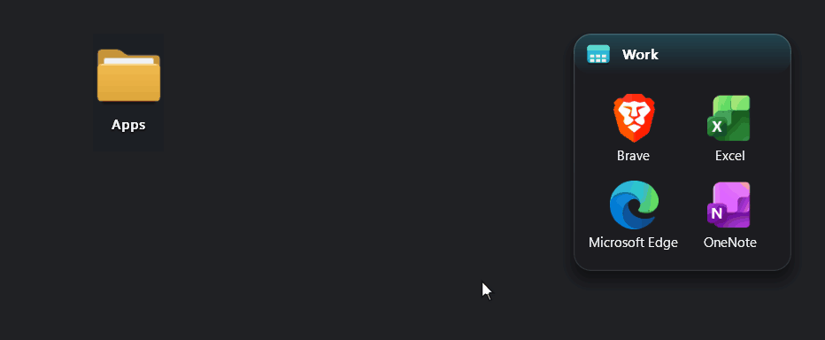
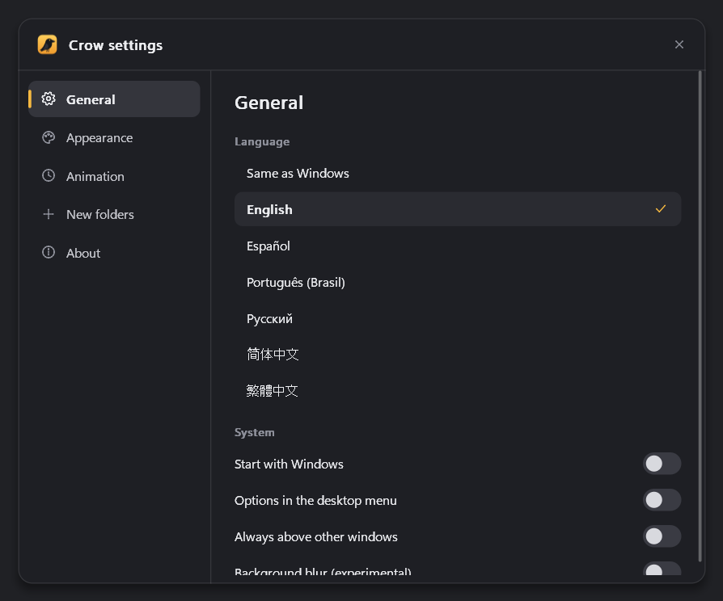
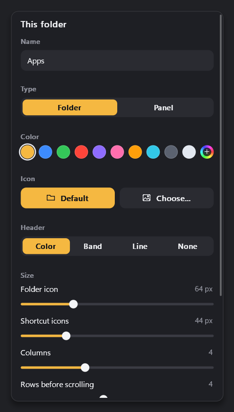
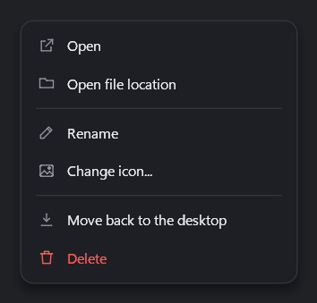

<h1 align="center">Crow Folder Organizer</h1>

<p align="center">
  
</p>

Crow FO (Folder Organizer) is a tiny, highly customizable desktop folder organizer for Windows. Group your shortcuts into folders that open when you hover over them, or keep them in panels that stay open.



## Download

Get `CrowFOSetup.exe` from the [latest release](../../releases/latest) and run it. That's all you need.

It installs for your user only, so no admin rights are required. It can start Crow FO with Windows and add a "Crow FO" entry to the desktop right-click menu. Uninstall it any time from Windows Settings, under Apps.

If you allow it, Crow FO looks for a new version each time it starts. When there is one, a small window offers it, and one click downloads, checks and installs it. Your folders and settings stay as they are. You can turn this on or off in the installer or in Crow FO settings.

Windows may show a SmartScreen warning the first time, because the installer is not signed yet. Click "More info" and then "Run anyway".

Prefer no installer? Download `CrowFO-portable.exe` and run it from anywhere. To install without any window, for example from a script, run `CrowFOSetup.exe /S`.

## Features

- Customizable folders and panels that can be used to store multiple shortcuts and organize your desktop
- Smoothly animated (also customizable)
- Customizable icons
- SUPER small footprint on your computer
- Did I say it is customizable?
- Available in:
  - English
  - Español
  - Português Brasileiro
  - Русский
  - 简体中文
  - 繁體中文

<p>
  
  
  
</p>

## Footprint

| | |
|---|---|
| CrowFO.exe | about 300 KB |
| Memory when idle | about 100 KB |
| CPU when idle | 0% |

## Translating

Translations are plain text files in [lang](lang). See [lang/README.md](lang/README.md) to add a language or fix one.

## Building from source

Only needed if you want to work on Crow FO. You need [Rust](https://rustup.rs).

```sh
rustup target add x86_64-pc-windows-msvc
cargo build --release -p crow
cargo build --release -p crow-setup
```

Both files end up in `target\x86_64-pc-windows-msvc\release`.

To change the version, edit `[workspace.package]` in `Cargo.toml`. It's the only place it lives.

To publish a release, change `version` under `[workspace.package]` in `Cargo.toml`, then commit and push. Then click "Run workflow" in the Actions tab. GitHub builds and tests everything, creates the tag and puts the files up on the releases page. Pushing commits never publishes anything by itself.

## License

Crow FO is released under the [MIT License](LICENSE).
